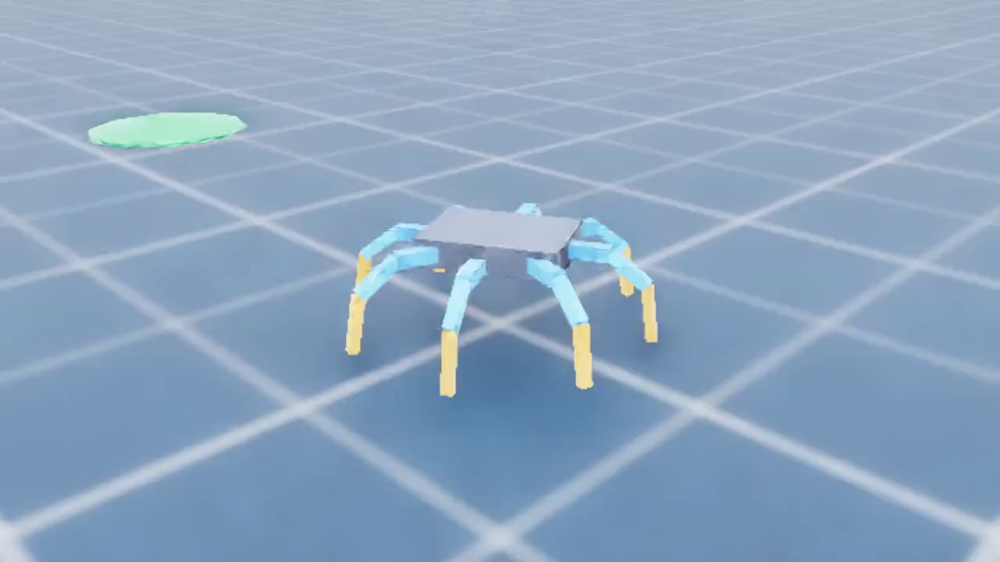

# DKSH-Sw-contest

Unity와 NVIDIA Isaac Lab에서 사용할 수 있는 6족 spiderbot 강화학습 프로젝트입니다.

현재 보행 학습의 모터 구성은 **몸체–coxa MG996R 6개 + 다리 RC920DMG 12개**입니다.
2026-10-19 모터 정정 및 계단 재학습은 [MG996R 실행 기록](isaaclab_project/docs/mg996r_hip_correction.md)을 참고하세요.

분리 CAD 다리를 사용한 **6족 조립 모델**과 Unity 프리팹도 제공합니다.
[모델 파일, 실행법 및 보정 가정](isaaclab_project/assets/spiderbot_variants/README.md)을 참고하세요.
Isaac Lab 실행 시 `-RobotModel cad8` 또는 `-RobotModel cad6`로 선택할 수 있습니다.



## 개발 컴퓨터 선택

이 저장소는 한 컴퓨터에 모든 도구를 동시에 실행하는 방식으로 운영하지 않습니다. RTX 3070·RAM
32GB 장비는 Isaac Sim 4.5/Isaac Lab 학습과 정책 검증을 담당하고, RAM 16GB·내장 GPU 장비는
Unity 및 headless ROS2/Nav2 통합을 담당합니다. 그보다 낮은 사양의 장비는 사양에 따라 Unity 단독,
정적 테스트 또는 문서·코드 리뷰만 수행합니다.

설치 전 반드시 [개발 컴퓨터 요구사항 및 작업 분담](DEVELOPMENT_REQUIREMENTS.md)에서 해당 장비의
등급, 금지되는 동시 실행 조합과 컴퓨터 간 결과 전달 규칙을 확인하세요.

## 6족 자율 탐색 빠른 시작

Unity `LidarScene`에는 기존 Frontier 탐지·군집·목표 선택을 보존한 독립 실행 경로가 구성되어
있습니다. 최소 8방향 A*, 이진 clearance, line-of-sight waypoint 압축,
`CharacterController` 추종 및 단일 exploration coordinator를 사용합니다. ROS 브리지와
locomotion adapter는 독립 실행 동작을 방해하지 않도록 씬에서 기본 비활성 상태입니다.

ROS2 전환 경로는 `ros2` 폴더에 분리되어 있습니다. Docker Desktop을 시작한 뒤 다음처럼
Unity TCP Endpoint만 먼저 올립니다.

```powershell
.\ros2\manage.ps1 Start
.\ros2\manage.ps1 Validate
```

Unity Play Mode에서 `/clock`, `/scan`, `/odom`, `/tf`를 게시할 때만 headless
SLAM/Nav2 launch를 실행합니다. ROS 측은 Jazzy, SLAM Toolbox, SmacPlanner2D,
MPPI Omni, velocity smoother, collision monitor와 검증된 Frontier 후보 v1.6.1을 사용합니다.
현재 16 GB RAM·내장 Intel Arc PC에서는 Unity와 이 headless 스택만 함께 실행하고,
Isaac Lab 학습은 반드시 별도 세션에서 실행합니다. 상세 명령, 자원 상한 및 실측치는
[ROS2/Nav2 실행 안내](ros2/README.md)를 참고하세요.

Unity와 ROS2를 서로 다른 네트워크의 두 컴퓨터에서 연결하려면 Tailscale을 사용할 수 있습니다.
ROS2 컴퓨터에서 `./ros2/manage.ps1 Start` 후 관리자 PowerShell로
`./ros2/tailscale.ps1 Configure`를 실행하고, 출력된 `100.x.y.z` 주소를 Unity의
`Ros2UnityBridge` IP에 입력하세요. Docker의 ROS 포트는 로컬 전용으로 유지되며, 원격 접속은
tailnet 안에서만 허용됩니다. 자세한 조건과 해제 방법은 [ROS2/Nav2 실행 안내](ros2/README.md)를 참고하세요.

이 개발 PC 자체에 원격 접속하려면, 관리자 PowerShell에서
`./scripts/enable_tailscale_rdp.ps1`을 한 번 실행하세요. 이 스크립트는 Windows RDP를
활성화하되 Tailscale 주소 범위에서만 3389/TCP를 허용합니다. 개인 노트북에서는 출력된
`mstsc /v:100.x.y.z` 명령이나 MagicDNS 이름으로 접속합니다.

## Isaac Lab 빠른 시작

기본 학습은 **관절 절대각 직접 출력(v2)** 방식입니다. 기본 gait에 작은 각도를 더하는
방식을 사용하지 않으며, 정책이 허용 범위 전체에서 각 관절의 목표각을 선택합니다.
관절 제한·명령 변화 속도·접지·에너지 비용과 연속 계단 코스를 포함합니다.
[직접 관절각 학습과 단계별 실행](isaaclab_project/docs/joint_angle_training.md)을 먼저 참고하세요.
혼합 CAD6의 새 학습은 `revised_v7`을 사용해 tibia 말단 지지를 학습하고 무릎/근위부 접지를
벌점 처리합니다. [Dynamic Gait 적용 검토](isaaclab_project/docs/dynamic_gait_review.md)도 함께 제공합니다.
현재 혼합 서보 CAD6는 `run_cad6.ps1`로 실행합니다. MG90S 지원은 제거했습니다.
공통 실행기의 기존 MG996R baseline v0는 `-ControlMode legacy`로 선택할 수 있습니다.
v1 모델은 v2에서 새로 학습해야 합니다.

현재 구성은 Isaac Sim 4.5.0과 호환되는 Isaac Lab 2.1.0/Python 3.10을 사용합니다. NVIDIA GPU와
Isaac Sim 4.5 standalone 설치가 필요하며, 기본 설치 위치가 다르면 경로를 지정합니다.

```powershell
git submodule update --init --recursive
.\setup_isaaclab.ps1
.\run_cad6.ps1 -Mode check -NumEnvs 4
```

```powershell
.\setup_isaaclab.ps1 -IsaacSimPath "D:\path\to\isaac-sim-4.5"
```

설치 상태나 Isaac Sim 자체 동작을 별도로 확인하려면 빈 뷰어 또는 Isaac Lab 기본 Cartpole 학습을
실행할 수 있습니다.

```powershell
.\run_isaaclab.ps1 -Mode isaac-smoke
.\run_isaaclab.ps1 -Mode viewer
.\run_isaaclab.ps1 -Mode cartpole -NumEnvs 32
```

성공하면 `DKSH_ISAACLAB_SMOKE_PASS`가 출력됩니다. 실제 PPO 학습은 다음처럼 시작합니다.

```powershell
.\run_cad6.ps1 -Mode train -NumEnvs 32 -MaxIterations 1000 -AllowProvisionalCad
```

혼합 CAD6 학습 결과는 `logs/rsl_rl/dksh_mg996r_hip_cad6_jointangles_v2` 아래에 저장됩니다.
공통 실행기의 기본 8족 결과는 `logs/rsl_rl/dksh_spider_jointangles_v2` 아래에 저장됩니다.
`-ControlMode legacy`의 v0 로그 경로는 `logs/rsl_rl/dksh_spider_navigation_l2v1`입니다.

## 학습 환경 선택

`-Environment`로 평지(`flat`), 좁은 틈(`narrow`), 진동 바닥(`vibrating`),
낙하물 위험구역(`falling_debris`), 요철·단차(`rough`), 복합 환경(`mixed`), 연속 계단(`stairs`)을 선택합니다.
`-Difficulty`는 0~1이며 기본값은 0.5입니다. `-Seed`로 무작위 시드를 지정할 수 있습니다.

```powershell
# 학습된 모델 없이 좁은 통로를 화면에서 확인
.\run_isaaclab.ps1 -Mode preview -Environment narrow -Difficulty 0.7 -NumEnvs 1

# 진동 바닥, 낙하물, 복합 환경 학습
.\run_isaaclab.ps1 -Mode train -Environment vibrating -NumEnvs 32 -MaxIterations 1000
.\run_isaaclab.ps1 -Mode train -Environment falling_debris -Difficulty 0.3 -NumEnvs 32
.\run_isaaclab.ps1 -Mode train -Environment mixed -Difficulty 0.5 -Seed 42 -NumEnvs 32

# 학습한 복합 환경 정책을 낙하물 구역에서 평가
.\run_isaaclab.ps1 -Mode evaluate -Environment falling_debris -NumEnvs 4 -Steps 1000
```

v0 정책은 모든 환경에서 Unitree L2 거리 16개와 유효값 16개를 입력받습니다. 직접 각도 v2 정책은
이 32개 값과 지형 높이 9개·바닥 속도·낙하물 정보를 포함합니다. 모든 환경에서 CAD6 140개,
8족 166개의 동일한 입력 구조를 사용합니다. 비평지 환경은 별도
`*_obstacles` 로그 폴더를 사용합니다. L2의 360°×96° NEGA 시야(-6°~90°), 수평 5.55 Hz,
4.5 mm 분해능을 반영합니다. 기존 L1 탐색 체크포인트는 관측 의미가 달라 다시 학습해야 합니다.
`preview`는 기본 자세로 환경을 확인하는 모드입니다. 학습한 보행을 보려면 `play`를 사용합니다.
환경별 동작과 실행 예시는 [학습 환경 안내](isaaclab_project/docs/training_environments.md)를 참고하세요.

가장 최근 체크포인트를 창 없이 유한 시간 검증하려면 다음 명령을 사용합니다.

```powershell
.\run_isaaclab.ps1 -Mode evaluate -NumEnvs 4 -Steps 500
```

특정 체크포인트를 지정할 때는 `-Checkpoint`를 함께 전달합니다. 화면에서 목표 지점과 동작을
재생하려면 다음 명령을 사용합니다(체크포인트 생략 시 가장 최근 모델 사용).

```powershell
.\run_isaaclab.ps1 -Mode play -NumEnvs 1
.\run_isaaclab.ps1 -Mode play -NumEnvs 1 -Checkpoint "C:\path\to\model.pt"
```

포함된 `balance_baseline.pt`는 이전 84차원 관측 정책이므로 새 환경에서 자동으로 사용하지 않습니다.
새 체크아웃은 `train`을 실행한 뒤 `play` 또는 `evaluate`를 실행해야 합니다.

L2 실측 점군을 정책 입력의 LiDAR 부분과 같은 32개 값으로 변환하는 예제와 실제 센서 적용 시
필요한 좌표계·전처리 조건은 [학습 환경 안내](isaaclab_project/docs/training_environments.md#실제-l2-점군-입력)에 있습니다.

ROS2 실기 연결은 공식 SDK2를 사용하며 UDP와 TTL UART 실행법은
[ROS2/Nav2 실행 안내](ros2/README.md#unitree-l2-hardware)를 참고하세요.

기존 v0 환경 ID는 `Isaac-DKSH-Spider-Navigation-Direct-v0`입니다. 기본 로봇은
8개 다리, 24관절의 primitive baseline 모델입니다. CAD6 학습의 현재 혼합 서보 가정은
몸통 hip 6개 MG996R, femur/tibia 12개 RC920DMG입니다. MG996R 사양과 임시 토크 한도,
RC920DMG 데이터의 검증 상태 및 질량 가정은 [MG996R hip 보정 문서](isaaclab_project/docs/mg996r_hip_correction.md)를
참고하세요. 현재 CAD6 실행 경로는 MG996R hip과 RC920DMG 다리 구성을 사용합니다.

현재 CAD6는 `main`의 `onshape_20260928` URDF/USD, 조립 영점, ±90° 관절 한계와
CAD 질량 1.792339 kg + L2 0.230 kg을 사용합니다. 잠정 CAD를 학습할 때는
`-AllowProvisionalCad`가 필요합니다. [직접 관절각 학습 안내](isaaclab_project/docs/joint_angle_training.md)를
따르며, 이전 CAD나 관측 계약의 체크포인트로는 재개하지 않습니다.

Unity 프로젝트는 `DKSH SW Project`에 유지됩니다. Unity의 FBX는 외형 참고용이고, Isaac Lab은
안정적인 학습을 위해 동일 치수의 primitive URDF에서 변환한 로컬 USD를 사용합니다. URDF 생성
소스도 함께 보관되므로 치수와 질량을 바꾼 뒤 USD를 다시 만들 수 있습니다.

```powershell
.\rebuild_spiderbot_asset.ps1
```

Isaac Sim 4.5는 변환 파일을 정상 기록한 뒤 종료 코드 1을 반환할 수 있습니다. 재생성 스크립트는
필수 USD 4개가 실제로 생성됐는지 검사하며, 이 경우 경고를 표시하고 성공으로 처리합니다.

## 기존 v0 검증 기록

- 물리 주기 200 Hz, 정책 제어 주기 50 Hz
- 기본 8족 로봇: 모든 환경의 정책 관측 116차원, 가치함수 관측 132차원, 연속 행동 24차원
- CAD 6족 로봇: 모든 환경의 정책 관측 98차원, 가치함수 관측 114차원, 연속 행동 18차원
- 무작위 방향/거리 목표, 목표 도달·낙상·영역 이탈·시간 제한 종료
- PPO 보상 항목과 성공/낙상/시간초과를 TensorBoard 로그에 기록
- 초록색 원판으로 각 병렬 환경의 목표 반경 표시

전체 단위 테스트는 PyTorch가 설치된 Isaac Lab Python 환경에서 실행합니다. L2 점군 변환과 실행
옵션 테스트만 확인할 때는 일반 Python으로도 실행할 수 있습니다.

```powershell
.\IsaacLab\isaaclab.bat -p -m unittest discover -s .\isaaclab_project\tests -v
python -m unittest discover -s .\isaaclab_project\tests -p test_l2_pointcloud_features.py -v
```

이전 관측 형식의 기준 모델은 RTX 3070에서 32개 병렬 환경 × 500 스텝 스모크 테스트와 PPO
500회 학습을 통과했습니다. 이 결과는 새 L2 입력 형식의 실행·학습 검증으로 간주할 수 없습니다.
