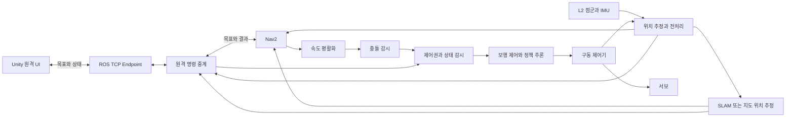

# Unity 원격주행 웨이포인트 지정 시스템 계획

작성 기준: 2026년 10월 12일. 대상은 자체 제작 6족 스파이더봇과 Unitree L2이며, ROS2와 Nav2는 로봇에 탑재한 Raspberry Pi에서 실행한다. Pi 모델과 RAM, 실제 상태 추정 장치와 구동 제어기는 착수 단계에서 확정한다.

Unity는 지도와 실제 로봇 상태를 표시하고 사용자가 지정한 이동 임무를 보낸다. Raspberry Pi는 위치 추정, 경로 계획, 장애물 대응과 임무 관리를 수행한다. 로봇의 구동 제어기는 보행 명령을 실행하고 통신이나 프로그램이 멈춰도 자체적으로 주행을 정지한다. 개발은 단일 목표의 시뮬레이션 검증부터 시작해 Pi 연동, 실물 평지 주행, 복수 웨이포인트와 인터넷 접속 순으로 확장한다.

## 1 목표와 개발 범위

첫 버전의 목표는 사용자가 2D 지도에서 위치와 도착 방향을 선택하고, 한 지점까지 이동하는 과정을 확인하고 취소할 수 있는 시스템이다. 목표를 수신했다는 응답, Nav2가 이동을 접수한 상태, 실제 도착과 정지를 각각 표시한다.

| 구분 | 포함할 기능 |
|---|---|
| 첫 버전 | 2D 지도, 실제 로봇 위치, 목표와 방향 선택, 경로 표시, 이동 요청, 진행 상태, 취소, 소프트웨어 정지, 연결 상태, 기록 |
| 후속 버전 | 최대 10개 지점의 순차 이동, 순서 편집, 임무 저장, Tailscale을 통한 인터넷 접속, 선택적인 3D 점군 표시 |
| 별도 검증 후 확장 | 경사면, 단차, 낙하 위험, 계단, 자동 탐색과 수동 이동의 전환, 다중 로봇 |

초기 실물 운용 범위는 조사한 평지와 통제된 시험 구역이다. 2D 지도에서 빈 공간으로 보이는 것만으로 발 디딤이나 낙하 안전을 보장하지 않으므로 단차와 낙하 구역은 금지 영역으로 지정한다. 주변 사람이 있는 공개 공간에서의 운용은 초기 인수 범위에 포함하지 않는다.

## 2 기존 구성과 필요한 보완

| 구성 | 현재 기반 | 계획에 반영할 작업 |
|---|---|---|
| Unity | `6000.5.3f1`, ROS-TCP-Connector `v0.7.0`, LiDAR와 자율 탐색 시뮬레이션 | 원격 조종 전용 씬과 지도 UI 추가 |
| ROS2 | Jazzy, Ubuntu 24.04 기반 Docker, SLAM Toolbox, Nav2 | Pi 배치 구성, 명령 중계, 운용 상태와 제어권 관리 추가 |
| Nav2 | SmacPlanner2D, MPPI Omni, velocity smoother, collision monitor, `navigate_to_pose` | 실물 속도와 보행 특성에 맞는 별도 설정 작성 |
| L2 | SDK2 고정 커밋, UDP와 UART 설정, 점군과 IMU, 2D scan 변환 | ARM64 빌드, 실제 수신, 장착 위치와 필터 검증 |
| Unity 이동 연결 | 센서와 위치를 발행하고 `cmd_vel`로 CharacterController를 이동 | 실물 조종 씬은 로봇의 지도와 위치를 구독하도록 분리 |
| Pi 보행 예제 | `CORE.py`의 68차원 관측과 18차원 보정 행동 추론 | 실측 관측, 반복 제어, 기준 보행과 관절 목표, 구동 제어기 연결 추가 |
| 저장된 보행 정책 | 과거 CAD와 L1 탑재 조건의 예비 정책 | 최신 CAD, L2 하중, 관절 순서와 실제 구동기를 기준으로 재검증 |

현재 L2 하드웨어 launch와 compose의 실행 경로에는 Unity TCP Endpoint와 원격 명령 중계가 함께 구성되어 있지 않다. 센서 실행만으로 원격 UI 접속까지 준비되는 것으로 해석하지 않고, Pi 통합 launch에서 필요한 프로세스를 함께 구성한다.

기준 파일은 [개발 환경 기준](DEVELOPMENT_REQUIREMENTS.md), [ROS2 실행 안내](ros2/README.md), [Nav2 설정](ros2/config/nav2_low_resource.yaml), [Pi 보행 예제](RSPI/scripts/CORE.md), [예비 정책의 적용 제한](isaaclab_project/policies/mg90s_cad6_velocity_l1v1/README.md)이다.

## 3 착수 전에 확정할 조건

| 결정 항목 | 현재 전제 | 확정할 내용과 완료 조건 |
|---|---|---|
| 로봇과 구동기 | 자체 제작 6족 | 최신 CAD, 18개 관절 이름과 방향, 링크 치수, 실제 서보, 관절 한계와 구동 인터페이스를 기록 |
| 로봇 컴퓨터 | Raspberry Pi 사용 예정 | 모델, RAM, 64비트 OS, 냉각, 저장공간과 전원 여유 확정 |
| 센서 연결 | L2 Ethernet UDP 우선 | Pi의 유선망은 L2, Wi-Fi는 원격 접속에 사용 가능한지 확인 |
| 위치 추정 | 방식 미확정 | 측정에 기반한 `/odom`, 몸체 속도와 좌표 변환을 정지와 보행 중 모두 제공 |
| 정책 관측 | 실제 공급 방식 미확정 | IMU, 몸체 선속도, 관절 위치와 속도, 보행 위상을 어디서 얻는지 확정 |
| 정지 장치 | 구동 제어기 미확정 | Pi 고장에도 동작하는 명령 타임아웃과 물리 정지 경로를 검증 |
| 원격망 | 같은 LAN부터 시작 | 인터넷 단계의 Wi-Fi 또는 이동통신 경로, Tailscale 접근 권한과 지연 측정 |
| 웨이포인트 | 한 지점부터 시작 | 복수 지점은 실패 시 전체 임무 중단, 임의 자동 건너뛰기 없음 |

실제 관절 피드백이 없는 구동기라면 명령 각도를 측정 각도로 대체해 기존 정책을 배포하지 않는다. 별도 계측이나 상태 추정의 오차를 검증하거나, 실제로 얻을 수 있는 관측을 사용하는 정책으로 변경한다. IMU만으로 안정적인 몸체 선속도와 모든 관절 상태가 확보되는 것으로 가정하지 않는다.

## 4 실행 환경과 Raspberry Pi 배치

| 실행 위치 | 담당 기능 | 배치 기준 |
|---|---|---|
| 사용자 PC | Unity 지도와 조작 화면 | Windows, 저장소의 Unity와 Connector 고정 버전, standalone 실행 파일 우선 |
| Raspberry Pi | L2 드라이버, 위치 추정, SLAM 또는 저장 지도 위치 추정, Nav2, 중계와 상태 감시, 보행 추론 | 64비트 Ubuntu 24.04 ARM64와 ROS2 Jazzy 우선, headless 실행 |
| 구동 제어기 | 관절 명령 실행, 명령 유효시간 감시, 정지와 상태 회신 | 실제 하드웨어 선정 후 프로토콜 고정 |
| 학습 컴퓨터 | Isaac Lab 학습과 정책 검증 | 기존 RTX 3070과 RAM 32GB 역할 유지, Pi에서 학습하지 않음 |

ROS2 Jazzy는 Ubuntu 24.04 ARM64를 Tier 1 대상으로 지정한다. 이것은 개별 L2 SDK 바이너리와 전체 로봇 처리량의 검증을 대신하지 않는다. SDK2의 해당 커밋에서 ARM64 라이브러리, ABI와 CMake의 프로세서별 경로를 확인하고 Pi에서 링크와 패킷 수신을 검증한다. [ROS2 플랫폼 기준](https://github.com/ros-infrastructure/rep/blob/master/rep-2000.rst), [L2 SDK2 빌드 설정](https://github.com/unitreerobotics/unilidar_sdk2/blob/0e3c51f512e6b8ff60b8c32f160b412cb48445c2/unitree_lidar_ros2/src/unitree_lidar_ros2/CMakeLists.txt)

Pi의 첫 실행 검증은 네이티브 ROS2로 진행한다. 이후 패키지와 launch 버전을 고정하고 systemd로 시작 순서와 재시작을 관리한다. Docker 배포가 필요하면 같은 소스로 ARM64 이미지를 만들고 네이티브 기준과 비교한다. Windows x64 이미지와 PowerShell 관리 절차, 기존 5GB 메모리 제한을 Pi에 그대로 적용하지 않는다.

L2 유선망과 원격 Wi-Fi의 주소 대역을 분리하고, L2 전용 인터페이스에는 외부망 기본 경로가 잡히지 않도록 설정한다. 센서의 목적지 주소, Pi의 수신 주소와 UDP 포트를 맞춘다. UART를 선택하면 모드 전환과 어댑터의 실제 전송률도 검증한다. Pi, L2, 서보의 전원 규격과 부하 전류, 전압 강하, 냉각과 케이블 고정을 실제 보행 조건에서 확인한다.

부팅 시 구동은 정지 상태로 시작한다. 센서와 위치 추정이 정상이고 Nav2 노드가 활성화된 뒤에도 원격 제어권과 운용 준비 조건이 성립해야 이동을 허용한다. 프로세스 재시작이나 Pi 재부팅은 이전 임무를 자동 재개하지 않는다.

## 5 데이터와 주행 제어 구조



Unity 원격 UI는 센서와 위치를 생성하지 않고 로봇이 보낸 상태를 표시한다. 기존 시뮬레이션 씬은 계속 가상 센서와 위치를 공급한다. 모드는 launch와 씬 설정에서 명시하고, 실물과 가상 데이터가 같은 토픽과 좌표 변환을 동시에 발행하지 않도록 한다.

Nav2 속도 명령은 평활화와 충돌 감시를 거친 뒤 최종 제어권 및 운용 상태 검사를 통과해야 보행 제어기로 전달된다. Unity는 서보 각도나 최종 `cmd_vel`을 직접 게시하지 않는다. Frontier 자동 탐색, 수동 조작, 웨이포인트 이동 사이에서는 한 번에 하나만 이동 목표와 속도를 소유한다. 모드 전환은 현재 임무 취소와 정지 확인 후 수행한다.

## 6 사용자 화면과 조작 흐름

지도 영역에는 로봇의 위치와 방향, 목표 마커, 계획 경로, 장애물과 금지 구역을 표시한다. 상단에는 선택한 로봇, 연결 상태, 제어권, 위치 추정 상태와 마지막 데이터 수신 시각을 표시한다. 우측에는 목표 목록과 현재 임무, 하단에는 이동, 취소와 주행 정지 버튼을 둔다.

1. 사용자가 로봇에 연결하면 상태와 최신 지도 정보를 받는다. 준비되지 않은 조건을 구체적인 문장으로 표시한다.
2. 지도 클릭으로 목표 위치를 선택하고 드래그로 도착 방향을 설정한다. 선택은 미리보기이며 이동을 발생시키지 않는다.
3. 지도 밖, 미탐색, 금지 구역과 장애물에 해당하는 목표는 선택 또는 실행을 막는다.
4. 이동 버튼을 누르면 요청 중 상태로 표시하고 같은 임무의 반복 전송을 막는다.
5. 접수 이후에는 진행 상태와 로봇 위치를 표시한다. 계획 경로는 갱신 가능한 예상 경로로 구분한다.
6. 취소나 정지 버튼은 요청 상태와 확인된 결과를 구분해 표시한다. 연결이 끊겨 결과를 모르면 정지 확인 불가 상태로 남긴다.
7. 재접속하면 서버의 현재 임무를 조회한다. 이전 목표를 자동 전송하지 않고 사용자가 다시 시작하도록 한다.

빈 지도 영역이더라도 최신 costmap의 로봇 여유 폭 검사를 통과해야 한다. 경로 미리보기 성공은 이후 장애물 변화나 실제 도착을 보장하지 않는다. 배터리, 기울기와 구동 상태는 실제 공급되는 항목만 표시하고, 값이 없으면 미측정으로 표시한다.

소프트웨어 주행 정지와 물리 비상정지는 별도 기능으로 둔다. UI 정지는 네트워크와 프로그램이 정상인 경우의 정지 요청이며, 물리 정지 장치가 실제 동작했음을 확인하지 않고 비상정지 완료라고 표시하지 않는다.

## 7 지도 좌표와 시간 기준

지도 클릭은 이미지 내부 위치에서 셀 좌표로 변환한 뒤 `OccupancyGrid.info.resolution`과 `origin`의 위치 및 회전을 적용한다. 셀 중심을 사용할 때 계산은 다음과 같다.

```text
cell_position = ((column + 0.5) * resolution, (row + 0.5) * resolution, 0)
goal_in_map = origin.position + origin.rotation * cell_position
```

텍스처의 위아래 방향, RawImage의 여백, 확대와 이동, 가로세로 비율을 같은 변환에서 처리한다. 지도 크기나 원점이 갱신돼도 목표는 지도 좌표로 보존하고 다시 그린다. 3D 표시에는 `From<FLU>()`와 `To<FLU>()` 등 Connector 변환을 사용한다. 축 변환은 `map`과 `odom` 사이의 위치 변환을 대신하지 않는다. [Unity 좌표 변환](https://github.com/Unity-Technologies/ROS-TCP-Connector/blob/v0.7.0/ROSGeometry.md)

| 좌표 변환 | 담당 발행자 | 요구 조건 |
|---|---|---|
| `map → odom` | SLAM 또는 지도 위치 추정 | 지도 기준 위치 보정 |
| `odom → base_footprint` | 로봇 상태 추정기 | 측정한 움직임에서 평면 위치와 방향 생성 |
| `base_footprint → base_link` | 몸체 자세 추정 | 보행 중 높이, roll과 pitch 반영 |
| `base_link → unilidar_lidar` | 장착 보정 | 실제 측정한 고정 장착 위치 |
| `unilidar_lidar → unilidar_imu` | 센서 보정 | SDK 기준과 실제 구성 확인 |

각 변환의 발행자는 하나로 유지한다. 현재 가정된 30mm 장착 높이와 `base_footprint`에서 LiDAR까지의 고정 변환은 실물에서 보정한다. 보행 중 센서 흔들림을 고려해 몸체 자세와 센서 장착을 분리한다. 다른 odometry 구조를 채택하면 같은 의미의 일관된 변환 체인을 문서화한다.

목표는 `map` 좌표계로 전달하고 ROS2 중계 노드가 실행 시 사용할 시간을 자신의 ROS clock으로 설정한다. 시뮬레이션은 `use_sim_time=true`, 실물은 `false`로 고정한다. 통신과 명령 유효시간 감시는 시뮬레이션 시간이나 PC와 Pi의 시계 일치에 의존하지 않고 monotonic clock을 사용한다.

지도 세션 ID는 지도 교체, SLAM 초기화와 재위치 추정으로 좌표 기준이 달라지는 상황을 구분한다. 일반 지도 갱신은 버전만 증가시키고 목표를 최신 지도로 다시 검사한다. 지도 세션이 바뀌거나 위치가 비정상적으로 뛰면 이동을 정지하고 기존 목표 미리보기와 임무의 유효성을 다시 확인한다.

## 8 통신 계약과 중복 명령 처리

이전의 `PoseStamped`, `Empty`, `String`만 사용하는 구성은 연결 시험에 사용할 수 있다. 실제 운용 버전에는 요청 식별자, 임무 식별자와 제어권을 포함한 형식이 필요하다. 새 패키지 `dksh_remote_interfaces`에서 메시지와 서비스를 정의하고 같은 정의로 Unity C# 클래스를 생성한다.

| 통신 경로 | 제안 형식 | 기능 |
|---|---|---|
| `/dksh/remote/acquire_control` | `AcquireControl.srv` | 인증된 세션에 제한 시간의 제어권 발급 |
| `/dksh/remote/submit_goal` | `SubmitGoal.srv` | 한 개 목표 접수와 요청 ID 회신 |
| `/dksh/remote/cancel` | `CancelMission.srv` | 지정한 임무 취소 |
| `/dksh/remote/stop` | `StopMotion.srv` | 현재 주행 억제와 정지 요청 |
| `/dksh/remote/get_state` | `GetRemoteState.srv` | 재접속 시 임무와 제어권 상태 확인 |
| `/dksh/remote/lease_challenge`와 `/dksh/remote/lease_response` | 전용 메시지 | 지연과 연결 끊김을 감지하는 제어권 갱신 |
| `/dksh/remote/status` | `RemoteStatus.msg` | 임무, 제어권, 준비 조건, 실패 원인과 구동 상태 |
| `/dksh/remote/robot_pose` | `PoseStamped` | 지도 기준 실제 위치 |
| `/dksh/remote/map` | 지도 메타데이터와 `OccupancyGrid` 연결 | 지도 세션 및 버전과 일치하는 지도 전달 |
| `/dksh/remote/path` | 임무 ID를 포함한 경로 메시지 | 현재 임무의 계획 경로 전달 |

목표 요청에는 프로토콜 버전, robot ID, 서버 발급 session 및 lease token, 최근 challenge ID, request ID, 지도 세션과 버전, 목표 `PoseStamped`를 포함한다. 중계 노드는 자신의 monotonic clock으로 challenge의 유효시간을 검사하고 오래 대기한 요청을 거절한다. 도착 허용 오차와 최대 실행 시간은 Pi 운용 프로필에서 정하고 UI가 임의로 확대하지 못하게 한다. 최대 실행 시간은 낮은 보행 속도와 목표 거리도 반영한다. 토큰을 포함한 설정은 Git에 저장하지 않는다.

서비스 응답은 요청 접수 또는 거절을 의미한다. Nav2 접수와 최종 결과는 같은 ID를 가진 상태 메시지로 전달한다. 중계 노드는 `NavigateToPose`의 비동기 ActionClient를 사용하고, 목표 접수와 feedback, result를 순서대로 처리한다. [Nav2 목표 이동 인터페이스](https://api.nav2.org/actions/jazzy/navigatetopose.html)

같은 request ID와 같은 내용이 다시 오면 이미 저장한 결과를 반환한다. 같은 ID에 다른 내용은 거절한다. 응답이 늦으면 상태를 먼저 조회하고 같은 ID로만 재시도한다. 이동 중 새 목표는 거절하고, 첫 버전에서는 취소와 정지 확인 후 새 목표를 받는다. 재부팅 후에는 제어권과 미완료 요청을 만료시키고 실행을 자동 복원하지 않는다.

목표 접수를 기다리는 동안 취소가 먼저 오면 취소 의도를 보관하고 최종 속도 출력을 막는다. 나중에 Nav2 goal handle을 받아도 즉시 취소한다. 늦게 도착한 이전 임무의 결과는 새 임무 상태를 덮어쓰지 못하도록 ID를 확인한다.

임무 상태는 접수 대기, 검사 중, Nav2 접수, 이동 중, 취소 중, 도착, 취소 완료와 실패로 관리한다. 연결 상태와 실제 구동 정지 상태는 별도 필드로 둔다. 주행 준비는 제어권, 지도 세션, 최근 센서와 위치, 유효한 TF, 활성 Nav2, 구동기 정상과 정지 장치 상태가 모두 충족할 때만 성립한다. 실패 코드는 계약에서 고정하고 UI에는 사용자가 이해할 수 있는 원인 문장으로 표시한다.

지도는 늦게 접속한 UI에도 최신 상태를 제공하도록 캐시와 재전송을 구성한다. ROS2의 지도·센서 QoS와 Endpoint의 구독 설정을 왕복 시험하고, 필요한 경우 별도 relay에서 호환한다. 서로 다른 시점의 지도 메타데이터와 이미지를 혼합하지 않는다. 서비스와 토픽의 기본 전송 방식은 Connector를 재사용하되 이 세션 관리 기능은 별도 구현한다. [Connector 서비스 호출 구현](https://github.com/Unity-Technologies/ROS-TCP-Connector/blob/v0.7.0/com.unity.robotics.ros-tcp-connector/Runtime/TcpConnector/ROSConnection.cs)

## 9 제어권과 통신 끊김 정책

기본 정책은 관제 연결이 유효할 때만 임무를 계속 수행하는 것이다. 연결이 끊기거나 제어권 갱신이 늦으면 Pi가 Nav2 임무를 취소하고 보행을 정지한다. 재접속 후에는 운용 준비를 확인하고 새 요청으로 시작한다. 통신 끊김에도 기존 임무를 계속 수행하는 모드는 초기 버전에 제공하지 않는다.

제어권은 한 세션만 가진다. Pi가 발급한 최근 challenge에 제한 시간 내 응답한 경우에만 갱신하고, 오래된 응답이나 같은 sequence는 무시한다. TCP에 대기하던 오래된 heartbeat가 도착했다는 이유로 연결이 정상이라고 판단하지 않는다. 센서, odometry, Nav2, 보행 제어와 원격 제어권의 상태도 각각 감시한다.

접속은 개발 때도 허용한 장치로 제한한다. 운영 Endpoint는 로컬 주소에 바인딩하고 Tailscale Serve의 TCP 전달과 tailnet 접근 정책으로 사용자 PC만 허용한다. 외부 인터넷에 ROS TCP와 DDS 포트를 직접 공개하지 않는다. 인터넷이 없는 LAN 시험은 별도 격리된 네트워크와 제한된 방화벽으로 진행한다. Tailscale의 raw TCP 전달은 지원되지만 애플리케이션 제어권은 별도 기능이다. [Tailscale TCP 전달](https://tailscale.com/docs/reference/tailscale-cli/serve)

첫 버전의 세션 발급에는 배치 시 주입하는 기기별 인증값을 검사하고 서버가 제어권 토큰을 발급한다. 클라이언트가 보낸 operator ID만으로 권한을 판단하지 않는다. ROS TCP Endpoint의 등록 단계에 허용한 원격 서비스와 상태 구독만 통과시키는 제한을 추가한다. 원격 클라이언트의 내부 `cmd_vel`, 관절 명령, 센서, `/tf`와 `/clock` 직접 게시를 거절하고 이 제한을 우회할 수 없는지 시험한다. UI에서 버튼을 숨기는 것만으로 제어 경로를 보호하지 않는다.

관제, 임무와 구동 상태를 따로 표시한다. 예를 들어 관제는 연결 끊김, 임무는 결과 미확인, 구동은 마지막 측정 이후 상태 미확인일 수 있다. PC에서 로봇의 실제 상태를 확인할 수 없으면 정지했다고 추정해 표시하지 않는다.

## 10 로봇 정지와 장애 대응

| 상황 | Pi와 구동 제어기의 동작 | UI 표시와 복구 |
|---|---|---|
| 임무 취소 | Nav2 취소, 후속 목표 차단, 안전한 보행 정지 | 취소 요청, 취소 확인, 구동 정지를 구분 |
| 소프트웨어 주행 정지 | 최종 속도 출력을 억제하고 임무 취소, 재시작을 명시적으로 요구 | 정지 중과 확인된 정지 표시 |
| 관제 연결 만료 | Pi에서 출력 억제와 임무 취소 | 연결 끊김, 재접속 후 상태 조회 |
| Pi 또는 보행 프로세스 정지 | 구동 제어기의 명령 타임아웃으로 정지 | 복구 후 준비 조건과 제어권 재확인 |
| L2·위치·TF 유효성 상실 | 이동 금지와 임무 중단 | 구체적인 원인과 상태 복구 표시 |
| 경로 없음 또는 진행 실패 | 해당 임무 실패, 남은 목표 중단 | 자동 반복 대신 재계획과 새 시작 |
| 물리 정지 장치 작동 | 하드웨어 정지 경로 실행 | 실제 장치 상태가 공급될 때만 작동 확인 표시 |

다족 로봇의 정상 정지는 전진·회전 명령을 0으로 만든 뒤 지지 자세를 유지하는 동작으로 설계한다. 서보 전원을 끊는 동작과 같은 것으로 취급하지 않는다. 즉시 전원 차단이 필요한 비상 상황은 실제 기구와 구동기에 맞는 별도 절차로 검증한다.

취소 완료는 Nav2 결과로 확인하고, 구동 정지는 제어기의 상태와 측정 속도로 확인한다. 명령이 0이라는 사실만으로 실제 정지를 확인하지 않는다. 최종 제어 상태 검사와 구동 제어기 타임아웃은 Nav2 정지 결과를 기다리지 않고 주행 출력을 억제할 수 있어야 한다.

보행 루프가 같은 속도 명령을 반복하거나 정규 관절 출력을 계속 생성하더라도 원래 입력의 유효시간을 갱신하지 않는다. 오래된 속도, 상태 관측이나 제어권으로 보행 출력을 유지하지 않도록 각 계층에서 유효성을 확인한다. Pi의 반복 출력이 구동 제어기의 watchdog을 갱신하며 과거 주행을 계속시키는 실패를 별도 시험한다.

Collision Monitor는 추가 장애물 대응에 사용하지만, CPU에서 실행되는 기능이며 hard real-time 안전 인증을 제공하지 않는다. 물리 정지와 구동 제어기 감시를 대신하는 것으로 취급하지 않는다. [Nav2 Collision Monitor의 범위](https://github.com/ros-navigation/navigation2/blob/jazzy/nav2_collision_monitor/README.md)

## 11 위치 추정과 실제 보행 연결

L2 점군과 IMU는 위치 추정의 입력으로 사용한다. 명령 속도를 적분한 값만으로 보행 로봇의 실제 위치를 대신하지 않는다. 센서 시간을 맞추고 장착 변환을 보정한 뒤 LiDAR와 IMU를 이용한 odometry 또는 검증한 다른 실측 상태 추정기를 선택한다. 정지 상태 drift, 이동 거리, 회전과 보행 흔들림을 시험하고 상태 추정 오차를 운용 프로필에 기록한다.

상위 경로는 `L2 → 전처리와 위치 추정 → SLAM/Nav2 → 몸체 속도 명령`으로 구성한다. 하위 경로는 `몸체 속도 명령 + 실측 상태 → 기준 보행과 정책 보정 → 관절 목표 → 구동 제어기`로 구성한다. 보행 정책에 LiDAR나 목표 좌표를 직접 추가하지 않고 학습 때 사용한 관측 계약을 유지한다.

기존 CORE 예제의 관측은 68개, 보정 행동은 18개이다. 실제 적용에는 관절 순서·영점·부호, 기준 자세, 각도와 속도 제한, 보행 위상, 행동 평활화, 센서 상태와 명령 타임아웃을 포함한 반복 제어가 필요하다. 실제 입력 공급과 최신 CAD 정책 검증을 완료하기 전까지 ONNX 출력은 구동하지 않는다.

현재 L2 scan 변환은 LiDAR 좌표계의 높이 ±0.10m 대역을 사용한다. 실제 장착 높이와 몸체 흔들림에 따라 지면이나 다리가 들어가거나 장애물이 빠질 수 있으므로 자기 몸체 제거, 지면 제거와 자세 보정 후 scan 높이 대역을 결정한다. 높은 장애물, 낮은 장애물과 낙하 위험이 이 대역에서 검출되는지 따로 확인한다.

MPPI Omni는 횡이동을 포함하는 현재 구성이다. 실제 로봇이 전진, 후진, 횡이동과 제자리 회전을 해당 범위에서 추종하는지 검증한다. 일부 방향을 제한해야 하면 planner, controller와 보행 프로필을 함께 바꾸고 통과 가능한 경로를 다시 시험한다. 구동기에서만 명령을 잘라 계획과 실행이 계속 어긋나는 상태로 운용하지 않는다.

## 12 Nav2 설정 조정과 성능 목표

다음 수치는 저장소의 현재 설정을 비교한 값이다. 실물에서 허용된 속도나 검증된 성능을 뜻하지 않는다.

| 항목 | 현재 Nav2 또는 Unity 설정 | 현재 CAD6 Velocity 학습 설정 | 계획 |
|---|---|---|---|
| 최대 전진 속도 | 0.35 m/s | 0.012 m/s | 정책 범위와 실측 추종 한계 중 더 낮은 값 사용 |
| 최대 후진 속도의 크기 | 0.20 m/s | 0.006 m/s | 후진 검증 후 별도 제한 |
| 횡속도 범위 | ±0.25 m/s | ±0.006 m/s | 횡이동 검증 후 controller와 함께 제한 |
| 회전 속도 범위 | ±0.8 rad/s | ±0.08 rad/s | 보행 안정성과 추종 오차 기준으로 제한 |
| 진행 판정 | 15초 동안 0.25m 이동 | 0.012 m/s 정속 이동을 가정하면 0.25m에 약 20.8초 | 실측 최소 순항 속도와 위치 오차에 맞게 거리와 시간 재설정 |
| 목표 허용 오차 | 위치 0.20m, 방향 0.30rad | 실물 결과 미확정 | 운용 목적과 위치 추정 오차를 기준으로 검증 |
| footprint | 0.50m × 0.46m 사각형 | 실제 다리 움직임 미반영 | 보행 중 다리의 외곽 범위와 불확실성 반영 |

비교 기준은 [현재 Nav2 프로필](ros2/config/nav2_low_resource.yaml)과 [CAD6 Velocity 설정](isaaclab_project/source/dksh_isaaclab/dksh_isaaclab/tasks/direct/spider_navigation/mg90s_cad6.py)이다. 실제 배포 정책의 학습 프로필과 메타데이터가 다르면 그 값을 기준으로 다시 비교한다. velocity smoother, MPPI와 구동 제어기가 같은 속도·가속도 한계를 사용하도록 맞춘다. 진행 판정 거리보다 위치 추정 잡음이 커서 허위 진행이 발생하는 상황도 시험한다.

Nav2 복구 동작인 회전과 후진의 속도, 이동 거리와 시간 제한도 같은 저속 보행 조건에 맞춘다. 해당 동작을 실물에서 검증하기 전에는 운용 Behavior Tree에서 비활성화한다. 목표 이동뿐 아니라 복구 동작도 최종 제어 상태 검사를 통과하도록 하고, 취소 후 다른 이동 명령 소스로 전환되지 않는지 확인한다.

아래는 구현과 시험을 시작하기 위한 제안값이다. 실제 지연, 정지 거리와 Pi 부하를 측정해 확정하고 설정 파일에 기록한다.

| 항목 | 초기 제안 | 검증 방법 |
|---|---|---|
| Unity 화면 | 30 FPS 이상 | 실제 관제 PC의 standalone에서 측정 |
| 로봇 위치 표시 | 5~10Hz | 수신 시각과 sensor/pose 유효시간 표시 |
| 지도 전송 | 갱신 시 최대 0.5~1Hz | 늦은 접속, 지도 확대와 느린 링크 시험 |
| 상태 전송 | 상태 변경 즉시, 진행 2~5Hz | request와 mission ID의 일치 확인 |
| 제어권 갱신 | 5Hz, 1초 유효시간을 출발점으로 사용 | 지연, 대기 데이터와 인터넷 접속 시험 |
| 구동 명령 타임아웃 | 최대 0.5초를 출발점으로 사용 | Pi와 보행 프로세스를 각각 중단하여 측정 |
| 보행 제어 주기 | 학습 설정에 맞는 50Hz 목표 | 전체 센서와 Nav2 부하에서 지연과 누락 측정 |
| 장시간 검증 | 최소 30분 동시 실행 | 최대 RAM, CPU, 온도, thermal throttling, swap, 디스크와 제어 주기 기록 |

제어권 만료 시간과 명령 타임아웃은 실제 정지 시간을 의미하지 않는다. 마지막 유효 입력 이후 출력 억제까지의 시간과, 그 이후 실제 로봇이 멈출 때까지의 시간 및 거리를 각각 측정한다. 장애물 여유 거리는 처리 지연 동안의 이동, 실측 감속 거리, 위치 오차와 발 움직임을 포함해 정한다.

첫 버전은 원시 점군을 원격으로 상시 보내지 않는다. 큰 지도와 3D 점군이 같은 TCP 연결의 정지·상태 전달을 지연시킬 수 있으므로 최신 데이터만 보관하고 전송량을 제한한다. 3D 점군은 후속 단계에서 다운샘플링하고 필요하면 별도 전송 경로로 분리한다. Pi에서 부하가 높으면 시각화 전송을 먼저 줄이고, 검증된 Nav2 설정을 조정한다. 필요한 제어 주기를 유지하지 못하면 Pi만의 전체 실행 구성을 통과로 판정하지 않고 연산 장비나 배치를 다시 결정한다.

보행 추론, 상태 감시, 점군 처리와 UI 전송은 작업을 분리하고 ONNX Runtime의 스레드 수부터 제한해 측정한다. 50Hz는 주기당 20ms이므로 추론 시간뿐 아니라 관측 수집과 명령 생성, 전체 주기의 최대 지연과 연속 누락도 기록한다. UI 전송과 로그 기록이 구동 루프를 막지 않도록 큐 크기와 기록량을 제한한다. Pi가 주행 가능 상태일 때 패키지 빌드나 정책 학습을 실행하지 않는다.

## 13 구현 파일과 작업 순서

아래 경로는 추가 또는 수정할 산출물의 계획이며, 현재 구현 완료를 의미하지 않는다.

| 위치 | 산출물 | 역할 |
|---|---|---|
| `DKSH SW Project/Assets/Scenes/RemoteNavigation.unity` | 원격 조종 전용 씬 | 실물·시뮬레이션 연결 프로필, 지도와 조작 화면 |
| `Assets/Scripts/RemoteNavigation/OccupancyGridView.cs` | 지도 뷰 | 텍스처, 클릭 좌표 변환, 지도 세션 갱신 |
| 같은 폴더의 `WaypointEditor.cs` | 목표 편집 | 위치·방향·목록 편집과 미리보기 |
| 같은 폴더의 `RosNavigationClient.cs` | ROS 클라이언트 | 서비스와 상태 구독, 타임아웃, 재접속 |
| 같은 폴더의 `NavigationStatePresenter.cs` | 상태 표시 | 연결·임무·구동 상태와 버튼 조건 |
| 같은 폴더의 `NavigationProfile.cs` | 운용 프로필 | 로봇 ID, 접속 대상과 지도 표시 설정 |
| `ros2/dksh_remote_interfaces` | 메시지와 서비스 | 버전, ID, 제어권, 요청과 상태 정의 |
| `ros2/dksh_remote_navigation` | ROS2 패키지 | goal gateway, pose relay, 제어권과 임무 관리 |
| `ros2/patches/endpoint_remote_access.patch` | Endpoint 접근 제한 | 고정 Endpoint 소스에 허용 서비스·토픽과 게시 방향 제한 적용 |
| `ros2/config/nav2_pi_hardware.yaml` | 실물 Nav2 프로필 | 측정한 속도, footprint, progress checker와 부하 설정 |
| `ros2/launch/remote_navigation.launch.py` | Pi 통합 실행 | Endpoint, 중계와 상태 감시를 센서·Nav2에 연결 |
| `ros2/deploy/pi` | 배치 문서와 service 설정 | ARM64 설치, 시작 순서, 설정과 기록 보관 |
| `RSPI/scripts`와 구동 펌웨어 | 실물 보행 실행기 | 관측 입력, 반복 추론, 기준 보행, 관절 목표와 정지 |

Unity의 표에서 `Assets`로 시작하는 경로는 `DKSH SW Project` 아래를 뜻한다. 새 asset과 씬의 `.meta`를 함께 관리한다. 기존 Frontier 씬과 시뮬레이션 브리지는 원격 UI와 분리하여 유지한다. 문서와 설정은 Git으로 공유하고 개인 주소, 인증 토큰과 대형 센서 로그는 저장소에 넣지 않는다.

## 14 개발 단계와 완료 조건

UI와 시뮬레이션 단계는 1인 개발 기준 약 10~16 작업일을 초기 추정으로 둔다. 새로운 상태 추정, 실물 보행 제어, 정책 재학습과 장비 대기는 여기에 포함하지 않는다. 실물 일정은 착수 점검에서 필요한 하드웨어와 검증 범위를 확정한 뒤 산정한다.

| 단계 | 선행 조건 | 작업 | 완료 조건 | 초기 작업량 |
|---|---|---|---|---|
| 0 실행 조건 확정 | 없음 | Pi 사양, 구동기, 관측 공급, 프로토콜과 운용 프로필 결정 | 인터페이스 계약과 실물 준비 항목 기록 | 1~2일 |
| 1 지도와 목표 UI | 단계 0의 인터페이스 | 고정 테스트 지도, 지도 표시, 클릭·드래그, 경로와 상태 화면 | 원점·회전·확대가 달라도 같은 실제 좌표 선택 | 2~3일 |
| 2 명령 중계 | 단계 0 | 메시지 생성, 접수·취소·결과, 제어권과 중복 처리 | 가짜 Nav2 서버로 정상·거절·취소 경쟁 조건 검증 | 3~4일 |
| 3 시뮬레이션 통합 | 단계 1과 2 | 기존 Unity 센서와 ROS2/Nav2 연결 | 한 지점 도착, 장애물 회피, 취소와 실패 처리 | 2~3일 |
| 4 장애 시험 | 단계 3 | 끊김, 재접속, 지도 초기화, 늦은 응답, 정지 | 자동 재전송과 자동 재개 없이 정해진 상태로 전환 | 2~4일 |
| 5 Pi 실행 검증 | 단계 0, 2와 4 | ARM64 빌드, 실제 L2와 전체 부하 시험 | 센서 수신과 제어 주기, 메모리와 냉각 조건 통과 | Pi 사양에 따라 산정 |
| 6 실물 평지 검증 | 단계 5, 상태 추정과 보행·정지 독립 검증 | 저속 직진·회전, 가까운 목표, 장애물, 통신 끊김 | 위치와 구동 정지를 확인하는 폐루프 주행 통과 | 준비 항목 완료 후 산정 |
| 7 복수 목표와 인터넷 | 단계 6 | 순차 목표, 목록 저장, Tailscale, 지연과 대역폭 시험 | 실패·끊김 시 남은 목표 중단, 재접속 상태 일치 | 별도 추정 |

원격 UI와 메시지 개발은 실물 준비와 독립적으로 진행할 수 있다. 실물 Nav2 이동 허용은 실제 odometry, 맞는 보행 정책, 구동 제어와 독립 정지의 검증을 모두 통과한 이후로 제한한다.

복수 목표의 첫 구현은 Pi의 임무 관리자가 `NavigateToPose`를 한 지점씩 호출하는 구조를 우선한다. 현재 단일 목표 구성을 재사용하고 각 지점의 결과를 명확히 관리할 수 있다. 한 지점이 실패하면 남은 지점을 실행하지 않는다. 지점별 작업 실행 등 요구가 생기면 `FollowWaypoints`와 waypoint follower 서버를 추가하고 같은 취소·상태 계약을 유지한다. [Nav2 복수 웨이포인트 인터페이스](https://api.nav2.org/actions/jazzy/followwaypoints.html)

## 15 검증 항목과 인수 기준

| 시험 | 입력과 상황 | 통과 기준 |
|---|---|---|
| 지도 좌표 | 음수 원점, 회전된 원점, 직사각형 지도, 확대·이동 | 좌표 변환 왕복 오차가 부동소수점 허용 범위 안에 있고 셀 선택 오차가 반 셀 이내 |
| 목표 방향 | 네 방향과 경계 각도 | 목표 quaternion이 정규화되고 지도 표시와 실제 방향이 일치 |
| 목표 검사 | 지도 밖, 미탐색, 장애물, 다리 여유 폭 부족 | 거절 원인이 표시되고 이동 목표가 실행되지 않음 |
| 단일 이동 | 장애물 없는 경로와 우회 경로 | Nav2 성공과 실측 최종 위치·방향이 설정한 허용 오차를 충족 |
| 중복 요청 | 같은 요청을 반복 또는 늦게 재전송 | Nav2 목표가 한 번만 생성되고 같은 결과 반환 |
| 취소 경쟁 | 목표 접수 전·직후·이동 중 취소 | 최종 속도 억제, 해당 목표 취소, 이전 결과가 새 상태를 덮어쓰지 않음 |
| 제어권 충돌 | 두 UI가 동시에 이동 요청 | 하나의 유효 제어권만 허용, 다른 요청은 거절 |
| 권한과 입력 검사 | 잘못된 인증값, 만료 토큰, NaN·무한대 목표, 내부 토픽 게시 시도 | 요청과 직접 제어 경로가 거절되고 오류가 기록됨 |
| 통신 끊김 | Wi-Fi 끊김, UI 종료·정지, TCP 지연 | 정한 제어권 만료 후 출력 억제, 실제 정지 시간과 거리 기록 |
| Pi 장애 | Nav2, 중계, 보행 프로세스 각각 종료와 Pi 중단, 과거 명령의 반복 출력 | 각 계층의 유효시간 검사와 구동 제어기 타임아웃 동작, 임무 자동 재개 없음 |
| 데이터 장애 | 센서 중단, 같은 stamp 반복, TF 단절, 위치 점프 | 유효성 상실을 감지하고 목표 접수와 주행을 차단 |
| 재접속 | 실행 중과 취소 중 연결 복구 | 서버 상태와 일치, 과거 목표 자동 전송 없음 |
| 저속 진행 | 실제 정책 범위의 가장 느린 주행과 제자리 회전 | 진행 판정의 허위 실패와 잡음에 의한 허위 진행 없음 |
| Pi 전체 부하 | L2, 위치 추정, SLAM/Nav2, 보행 추론, 원격 화면 | 30분 동안 필요한 제어 주기 유지, OOM·과열로 인한 운용 실패 없음 |
| 실물 보행 | 속도 범위와 방향, 자세 유지 정지 | 미리 정한 추종 오차·기울기·관절 제한과 정지 거리 충족 |
| 복수 목표 | 3개 지점 중 두 번째 실패 또는 취소 | 세 번째 목표 실행 안 함, 완료·실패 지점과 남은 목록 일치 |

시뮬레이션과 실물 평지 각각에서 대표 단일 목표 시나리오를 최소 10회 반복한다. 성공 여부뿐 아니라 위치와 방향 오차, 취소·정지 지연, 속도 추종 오차와 Pi 부하를 함께 기록한다. 실물의 허용 속도·정지 거리·기울기·오차 한계는 실제 주행 시험 전에 운용 프로필에 확정한다. 평균 성공률로 제어권 위반, 중복 실행이나 정지 실패를 상쇄하지 않는다.

클릭 변환과 중계 상태는 Unity Edit Mode 및 ROS2 자동화 시험으로 확인한다. 장치 종료, 지연과 센서 중단은 통합 시험으로 확인한다. 노드 활성화만 통과한 smoke test, CORE의 가상 입력 추론, 과거 CAD 정책의 시뮬레이션 결과를 실물 전체 시스템 인수 결과로 사용하지 않는다.

## 16 운영 기록과 변경 관리

임무 기록에는 request와 mission ID, 로봇과 지도 세션, 목표, 상태 전환, 실패 코드, 최종 위치와 정지 확인을 남긴다. 인증값과 제어권 토큰은 기록하지 않는다. 시험 기록에는 Pi 모델과 RAM, OS·패키지·정책 버전, 센서 장착 보정, 속도와 footprint 설정, 전원·냉각 상태를 함께 저장한다. 원시 센서 기록은 필요한 시험 구간만 보관하고 저장공간과 기록 회전을 제한한다.

저장 지도는 지도 파일과 위치 추정 설정을 묶어서 버전 관리한다. 지도 교체 시 새 지도 세션을 발급하고 이전 임무를 폐기한다. 초기에는 SLAM으로 지도를 만들고, 운용 단계에서는 검증한 저장 지도와 위치 추정 모드를 우선한다. 재부팅 후 위치가 확정되기 전에는 주행 준비 상태가 되지 않는다.

문제 발생 시 실물 이동을 억제한 상태로 직전 검증된 실행 프로필로 복원한다. 프로그램 재시작과 설정 복원은 주행 시작으로 연결하지 않는다. Unity, ROS2와 정책 버전 변경은 호환성 시험을 거친 뒤 함께 반영하고, Pi 설정과 Windows 개발 설정을 별도로 유지한다.
