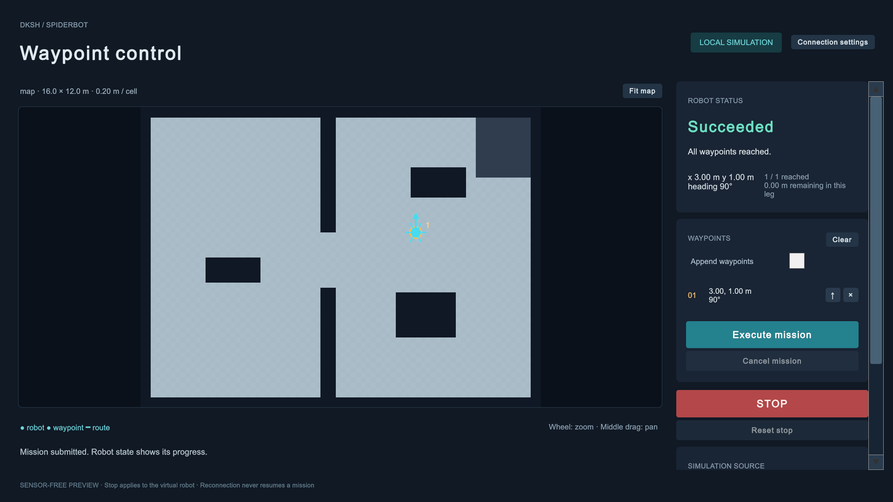

# 센서 없는 Unity 웨이포인트 데모

실제 LiDAR나 로봇 없이 지도에서 목표 위치와 도착 방향을 지정하고, 가상 로봇의 이동·취소·정지를
실행할 수 있다. Unity 단독 데모와 Python 원격 서버 데모는 바로 실행 가능하다. 기존 가상 LiDAR와
ROS2/Nav2를 연결하는 별도 씬·서버 어댑터·launch도 포함한다.



## Windows 실행 파일

이번 작업의 실행 파일은 `DKSH SW Project/Builds/RemoteNavigationClient/DKSHWaypoint.exe`에 있다.
더블 클릭하면 Unity Editor 없이 로컬 데모를 실행한다. 다른 PC로 옮길 때는 해당 폴더 전체를 복사한다.
`Builds`는 Git에 포함하지 않으므로 저장소만 받은 경우 아래 Unity 씬에서 실행하거나 직접 빌드한다.
창 모드로 실행하려면 저장소 루트에서 다음 명령을 사용한다.

```powershell
& '.\DKSH SW Project\Builds\RemoteNavigationClient\DKSHWaypoint.exe' -force-d3d11 -screen-fullscreen 0 -screen-width 1280 -screen-height 860
```

## Unity만 실행

1. `DKSH SW Project`를 Unity 6000.5.3f1에서 연다.
2. `Assets/Scenes/RemoteNavigation.unity`를 단독으로 열고 **Play**를 누른다.
   메뉴 `DKSH > Spiderbot > Remote Navigation > Create or Open Sensor-Free Demo`로도 열 수 있다.
3. 지도에서 빈 공간을 클릭한다. 누른 채 드래그하면 도착 방향을 지정한다.
4. **Execute mission**을 누른다. 경로, 로봇 위치, 도착한 지점 수, 현재 구간 잔여 거리가 표시된다.

`Append waypoints`를 켜면 최대 10개 지점을 추가한다. 목록의 `↑`로 순서를 바꾸고 `×`로 삭제한다.
`Clear`는 목록을 비운다. 휠은 확대·축소, 가운데 버튼 드래그는 지도 이동, `Fit map`은 원래 보기다.
미탐색 영역·장애물·지도 밖·로봇 여유 폭이 부족한 위치는 지정할 수 없다.

`Cancel mission`은 현재 임무와 남은 지점을 취소한다. `STOP`은 정지 상태를 유지하며 새 임무를
차단한다. `Reset stop`을 누른 뒤 **Execute mission**을 눌러야 다시 이동한다. `Test link loss`로
연결 끊김을 시험하고 `Restore link`로 복구해도 임무가 자동으로 재개되지 않는다.

이 데모의 지도는 합성 지도이고 로봇은 2D 위치 모델이다. 보행 정책·관절·서보·실제 SLAM을 실행하지
않는다. 이동 속도 0.65 m/s와 원형 footprint 0.35 m는 화면 시험용 값이다. 실제 6족 정책의 속도나
다리 크기를 나타내지 않는다.

## Python 서버를 통한 원격 실행

Python 3.10 이상이면 ROS2, Docker, 추가 pip 패키지가 필요 없다. 저장소 루트에서 실행한다.

```powershell
.\ros2\run_waypoint_demo.ps1
```

스크립트는 설치된 Codex Python 런타임을 먼저 사용하며, 없으면 일반 Python을 찾는다.
직접 지정하려면 `-PythonPath 'C:\path\to\python.exe'`를 붙인다.

Unity 화면 오른쪽 위의 **Connection settings**를 누른 뒤 Host `127.0.0.1`, Port `8765`, 빈 Token으로
**Connect**를 누른다. 지도와 로봇 위치가 서버에서 전달된다. 서버가 계산한 경로와 임무 상태를
표시하며, Unity는 직접 모터 속도나 ROS 토픽을 보내지 않는다. **Local demo**는 새 로컬 데모로 전환한다.

Raspberry Pi 또는 다른 Linux 컴퓨터에서도 저장소 루트에서 다음 명령으로 가상 서버를 실행한다.
이는 Pi의 실제 ROS2/Nav2·L2·보행 성능 검증과 별개다.

```bash
python3 ros2/tools/waypoint_gateway.py
```

다른 컴퓨터에서 접속할 때는 SSH 터널 또는 사설 VPN을 사용한다. 예를 들어 클라이언트에서
`ssh -L 8765:127.0.0.1:8765 pi@<Pi 주소>`를 실행하면 Unity는 계속 `127.0.0.1:8765`로 접속한다.
직접 사설 주소에 bind하려면 서버의 `DKSH_GATEWAY_TOKEN` 환경 변수에 16자 이상 비밀값을 넣고
`--host <사설 주소>`를 사용한다. Unity의 Token에도 같은 값을 입력한다. 외부 포트 공개나 방화벽 변경은
자동으로 수행하지 않는다. TCP 자체에는 TLS가 없으므로 공용 인터넷에 직접 노출하지 않는다.

## 기존 가상 LiDAR와 Nav2 연결

`RemoteNavigationNav2.unity`는 기존 `LidarScene`의 복사본이다. 기존 씬은 변경하지 않는다.
복사본에서는 자동 Frontier 탐색을 끄고 가상 `/scan`, `/odom`, `/tf`, `/clock` 발행과 `/cmd_vel`
추종을 켠다. UI는 원격 게이트웨이에 접속한다. 씬을 다시 만들려면
`DKSH > Spiderbot > Remote Navigation > Create or Open Nav2 Simulation` 메뉴를 사용한다.

Docker Desktop이 실행되고, [개발 장비 요구사항](../../DEVELOPMENT_REQUIREMENTS.md)을 충족하는 PC에서
이미지를 새 패키지를 포함하도록 빌드한다. 기존 스크립트는 빌드 전 디스크 여유 25 GB를 검사한다.

```powershell
.\ros2\manage.ps1 Build
$env:DKSH_GATEWAY_TOKEN = '<직접 정한 16자 이상의 비밀값>'
docker compose -f ros2/compose.yaml -f ros2/compose.waypoint.yaml up -d
```

Unity에서 `RemoteNavigationNav2.unity`를 단독으로 열고 Play를 누른다. 원격 설정 Token을 입력하고
Connect를 다시 누른다. 가상 센서의 ROS TCP Endpoint는 `127.0.0.1:10000`, 목표 게이트웨이는
`127.0.0.1:8765`다. SLAM 지도가 생성되고 유효한 map→base TF, 갱신되는 scan/odom/clock과
Nav2 action server가 있어야 목표를 받을 수 있다. 초기에는 현재 지도에 보이는 가까운 빈 공간을 고른다.

```powershell
docker compose -f ros2/compose.yaml -f ros2/compose.waypoint.yaml stop
```

ROS2가 이미 설치된 Pi/Linux에서는 `dksh_remote_navigation` 패키지를 colcon으로 빌드하거나,
ROS 환경을 source한 뒤 `python3 ros2/tools/waypoint_gateway.py --backend nav2-sim`을 실행할 수 있다.
이 어댑터는 simulation time과 `/clock`을 요구한다. 실물용 모드나 서보 제어는 제공하지 않는다.

Nav2의 [Jazzy NavigateToPose 정의](https://github.com/ros-navigation/navigation2/blob/jazzy/nav2_msgs/action/NavigateToPose.action)와
[rclpy 비동기 action API](https://github.com/ros2/rclpy/blob/jazzy/rclpy/rclpy/action/client.py)를 사용해
각 지점을 순서대로 실행한다. 취소 요청이 목표 접수보다 먼저 들어와도 늦게 접수된 handle을 취소한다.
취소 결과와 갱신되는 odometry의 정지 관측이 모두 확인되어야 `Stopped`를 표시한다. 확인할 수 없으면
`StopUnconfirmed`를 유지한다. 이는 실제 로봇의 독립 정지 장치를 대신하지 않는다.

## 인터페이스와 동작 규칙

현재 구현은 **NDJSON v1 TCP 게이트웨이**다. 계획서의 custom ROS service 생성 단계 대신, 센서 없는
클라이언트·서버 시험을 먼저 완료하기 위한 좁은 메시지 계약을 사용한다. 일반 ROS-TCP Endpoint는
가상 센서 연결에만 사용하며, 새 UI의 목표 명령 경로와 분리한다.

| 메시지 | 필드 및 동작 |
|---|---|
| `hello` / `welcome` | 버전·비밀값 확인, 서버가 새 operator session 발급 |
| `map` | 크기·해상도·음수/회전 원점·row-major 점유값, 지도 revision |
| `status` | 상태·위치·yaw·현재 구간 경로·지점 번호·정지 latch·server challenge |
| `command` | session, request ID, 순증가 seq, challenge, mission ID, map revision |
| 허용 명령 | `heartbeat`, `submit`, `cancel`, `stop`, `reset_stop`만 허용 |

좌표는 ROS `map` 프레임의 metre와 반시계 방향 yaw(rad)다. Unity 월드 X/Z 좌표를 직접 보내지 않는다.
지도 셀 중심은 `origin + R(origin_yaw) × ((i+.5)resolution, (j+.5)resolution)`이다. 지도 표시의
letterbox·확대·이동을 역변환한 뒤 같은 좌표를 선택한다.

서버는 단일 operator만 허용하고, 1초 heartbeat lease를 서버 monotonic clock으로 검사한다.
challenge는 발급 후 1초만 유효하다. 중복 요청·과거 seq는 재실행과 lease 갱신을 하지 않는다.
한 세션의 non-heartbeat 요청은 최대 512개, 임무는 128개로 제한하고 한도 도달 시 명시적 재접속을
요구한다. 입력은 16 KiB·초당 30개 명령으로 제한하며, 출력과 클라이언트 수신은 최대 2 MiB다.

Unity는 수신 시각을 별도로 저장한다. 큐에 쌓인 과거 상태를 처리한 시각으로 freshness를 갱신하지
않는다. 1.5초 이상 오래된 상태, 연결 종료, 목표 응답 시간 초과는 재접속을 요구한다. Unity는 정지
확인이 없는 통신 끊김을 `Disconnected`로 표시한다. 서버는 lease 만료 시 임무를 중단하고 정지를
유지한다. 연결 복구·프로그램 재시작으로 과거 목표를 자동 전송하지 않는다.

Nav2 지도의 revision은 게이트웨이 실행 세션과 지도 geometry/map-load identity를 식별한다.
일반 점유 셀 갱신은 같은 revision으로 전달하며 실행 중 장애물 대응은 Nav2가 맡는다. 지도 프레임·원점·
크기·map-load identity 변경은 진행 중 임무를 중단한다. 클라이언트 초안은 revision 변경 시 폐기한다.
같은 지도에서 셀만 갱신되면 화면의 확대·이동 상태는 유지한다.

Python 서버의 임무 기록은 `logs/remote_navigation/events.jsonl`에 저장한다. UTC 시각, 요청·임무 ID,
목표, 지도 revision, 상태 변화, 완료 지점 수, 최종 위치와 정지 확인을 기록한다. 인증값·operator session·
freshness challenge는 기록하지 않는다. 파일은 1 MiB마다 회전하며 이전 파일 3개까지 보관한다.
직접 실행 시 `--log-dir <경로>`로 바꿀 수 있다. Docker 실행 기록은 `ros2/logs/remote_navigation`에
남으며 Git에 포함하지 않는다. Unity 단독 로컬 데모의 상태는 화면에 표시하며 이 서버 기록은 생성하지 않는다.

## 검증

```powershell
.\ros2\run_waypoint_demo.ps1 -Mode Test
```

Unity Test Runner에서 `DKSH.Spiderbot.RemoteNavigation.Tests`의 EditMode 시험을 실행한다.
Python mock 서버를 기본 `127.0.0.1:8765`, 빈 token으로 실행한 상태에서는
`DKSH.Spiderbot.RemoteNavigation.Integration.Tests`의 PlayMode `GatewayIntegration` 시험도 실행한다.
이 시험 중 다른 Unity UI를 같은 게이트웨이에 접속시키지 않는다.

2026-10-13에 확인한 결과:

- Unity EditMode 10개 통과: 회전/음수 원점, letterbox와 확대·이동, footprint, A*, 취소, 순차 목표, 정지 복구.
- Python 35개 통과: 상태 기계, 중복/인증/lease/지도 교체, 실제 TCP 왕복, Nav2 비동기 callback 경쟁 조건, 기록의 비밀값 제외·파일 회전.
- Unity PlayMode 2개 통과: 실제 C#↔Python 연결의 목표 도착·접수 전 취소·재접속 정지, UI 정지 시 stale 데이터 거절.
- Unity 화면의 실제 PointerDown/Move/Up 경로로 `(3, 1) m`, 도착 방향 90° 지정 및 실행을 확인했다.
- Nav2 연동 씬에서 가상 센서 1개·ROS 브리지 1개·UI 1개와 Frontier 탐색 비활성 상태를 확인했다.
- 최종 Windows x64 빌드 성공: 오류·경고 0개. standalone 프로세스의 Direct3D 11 초기화·씬 로딩·정상 응답을 확인했다.

코드 리뷰에서 발견한 연결 만료 후 추가 이동, 이전 goal의 예외가 새 상태를 덮어쓰는 경쟁 조건,
즉시 완료된 goal의 상태가 역행하는 문제를 수정하고 회귀 시험을 추가했다. 중단되었던 odometry를
재수신하면 정지 관측 시간을 새로 계산한다. TCP 수신은 Unity main thread와 독립적으로 시각을 기록한다.

**Nav2 전체 실행은 이번 환경에서 Docker daemon이 실행되지 않아 검증하지 않았다.** launch 파일과
어댑터의 문법 및 action callback 시험을 통과한 것으로 ROS2 런타임 동작을 대신 주장하지 않는다.
Pi ARM64 실행, 실제 L2 드라이버 수신, 장착 TF, odometry/위치 추정, 보행 정책, 서보 폐루프 제어,
실제 정지 거리·성능·냉각은 장비를 확보한 뒤 별도로 검증해야 한다.
